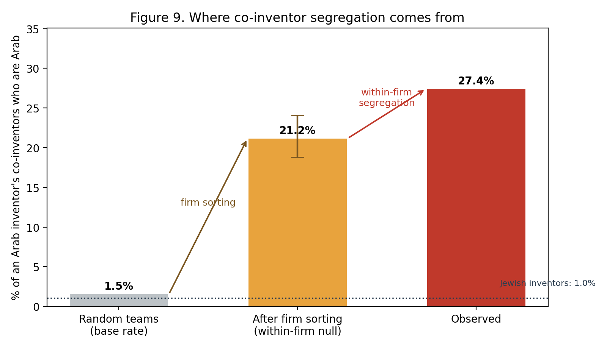
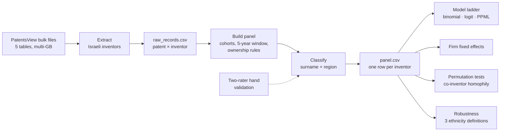
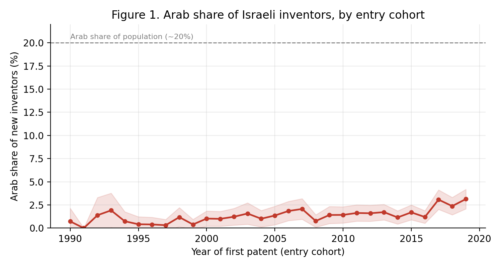
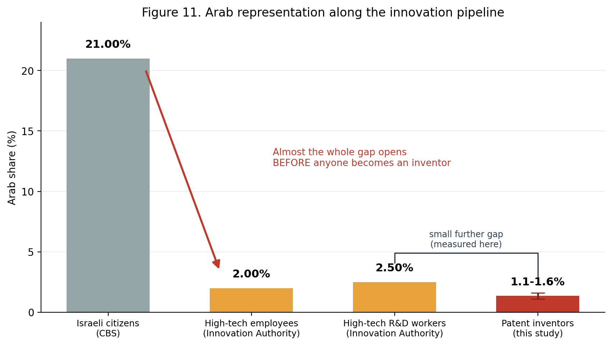
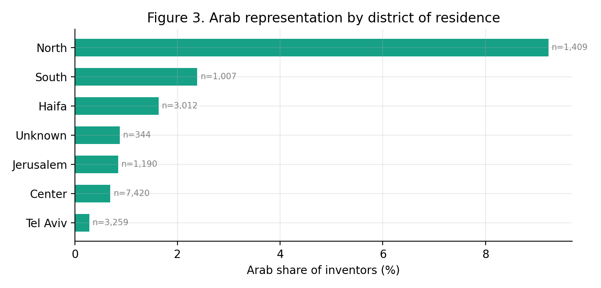
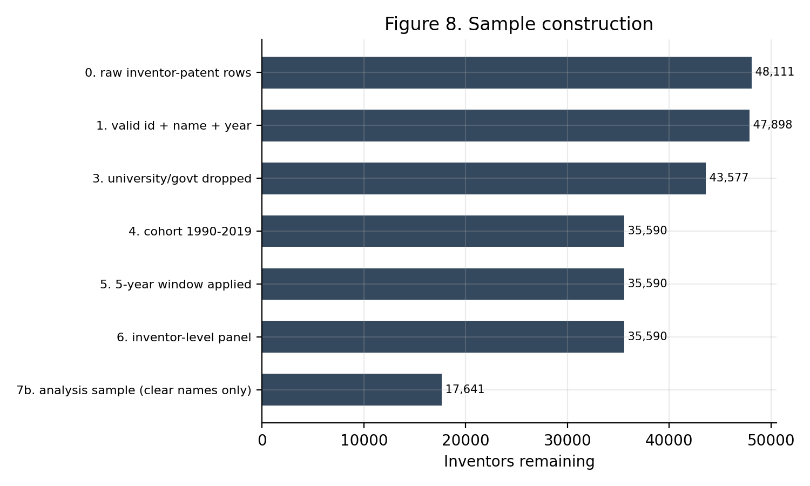

# Patent Inventor Pipeline

[](https://github.com/wardelias/patent-inventor-pipeline/actions/workflows/ci.yml)


An end-to-end, reproducible research pipeline over the complete USPTO patent record
(1976 onward). It extracts every Israeli-resident inventor from multi-gigabyte bulk files,
builds an inventor-level panel, classifies ethnicity with a validated surname model, and
tests where the Arab–Jewish gap in Israeli innovation actually opens, using a regression
ladder, firm fixed effects and permutation tests.

**Ward Elias & Mtanis Haddad** · Tel Aviv University · Entrepreneurship research seminar,
supervised by Dr. Lia Sheer

<p align="center">
  
</p>

## Key findings

| | Result |
|---|---|
| **Scale** | 225,165 inventor-patent records and 48,111 inventors extracted; 17,641 inventors in the analysis sample, 276 of them Arab (1.56%, against roughly 20% of the population) |
| **Intrapreneurship** | No significant Arab–Jewish difference in the share of patents produced inside an employer firm, across 18 specifications and 3 definitions of ethnicity |
| **Firm sorting** | Shuffling ethnicity across all inventors gives Arab inventors' teams a 1.5% Arab share; shuffling only within each firm gives 21.2%. Most of the clustering is explained by *which* firms employ Arab inventors |
| **Within-firm segregation** | The observed share, 27.4%, is significantly above the within-firm benchmark: even inside the same companies, collaboration is segregated |

The gap is not in who invents for their employer. It is in where Arab engineers are
hired, and who they are teamed with once they get there.

## Pipeline



| Stage | What happens | Code |
|---|---|---|
| Extract | Reads the zipped TSVs in chunks, selecting only needed columns, so multi-GB files fit in memory; keeps patents with at least one Israel-resident inventor | `extract_israeli_inventors.py`, `bulk_load.py` |
| Panel | One row per disambiguated inventor; entry cohorts 1990–2019; a uniform five-year exposure window from each first patent; university and government assignees removed by type code *and* by technology-transfer company name (Yissum, Ramot, Yeda and others are registered as ordinary companies) | `build_panel.py` |
| Classify | Three-bucket surname classifier (clear Arab / clear Jewish / ambiguous); city-to-district mapping with known USPTO geocoding errors excluded | `names.py`, `regions.py` |
| Validate | Hand-labelled sample stratified by predicted class, two independent raters; precision, recall, F1 and Cohen's kappa, reweighted to true class sizes so recall is not overstated | `validate.py`, `diagnose2.py` |
| Estimate | Model ladder (binomial corporate share, logit, PPML count) adding cohort, region and field controls; firm fixed effects; permutation tests with global and within-firm nulls; one targeted test per hypothesis (sponsorship, risk, legitimacy) | `analyze.py`, `homophily.py`, `mechanisms.py`, `simple_analysis.py` |
| Robustness | Three ethnicity definitions with different error structures (surname, Arab-majority locality, union of both); balance and sensitivity checks on unclassified names; a name-free count of Arab inventors among excluded records | `robustness.py`, `balance.py`, `coverage_floor.py` |
| Report | Publication tables (A–E) and figures | `explore.py`, `figures_extra.py` |

Full method details: [docs/METHODOLOGY.md](docs/METHODOLOGY.md).

## Engineering for correctness

- **Planted-effect test.** `make_synthetic.py` generates a dataset with a known true
  effect (odds ratio 0.55). The pipeline must recover it before it is trusted on real data.
- **30 invariant checks.** `selftest.py` verifies lexicon consistency, the academic
  exclusion rule, region mapping and panel invariants, and recomputes inventor totals
  from raw records for a random sample. Exit code 0 means every invariant holds.
- **Continuous integration.** Every push runs the full pipeline on synthetic data and
  asserts the planted effect is recovered ([workflow](.github/workflows/ci.yml)).
- **Conservative by design.** Classifier errors bias estimates toward zero, so the null
  result on intrapreneurship is a lower bound on any true gap, not an artefact.

## Quick start

Requires Python 3.10+.

```bash
git clone https://github.com/wardelias/patent-inventor-pipeline.git
cd patent-inventor-pipeline
pip install -r requirements.txt

make demo     # full pipeline on synthetic data, about a minute
make test     # planted-effect recovery + 30 invariant checks
```

### Running on the real data

1. Download these files from the PatentsView *Granted Patent Disambiguated* bulk data
   (free USPTO account) into one folder and leave them zipped:
   `g_location_disambiguated`, `g_inventor_disambiguated`, `g_application`,
   `g_assignee_disambiguated`, `g_cpc_current`.
2. Run the pipeline. It asks for the data folder, validates the files and builds
   everything (the first read takes 10–40 minutes):

```bash
cd src
python START_HERE.py
python robustness.py
python explore.py
python homophily.py
```

## Repository layout

```
src/        pipeline code (entry point: START_HERE.py)
tests/      planted-effect regression test
results/    aggregate tables from the real-data run
figures/    figures from the real-data run
docs/       methodology
```

## Selected figures

| | |
|---|---|
|  |  |
|  |  |

## Limitations

- Surname classification identifies an estimated 35–40% of Arab inventors. The
  resulting misclassification attenuates estimates toward zero.
- Only 77 firms employ inventors from both groups; the within-firm result rests on them.
- Everyone in the sample already holds a US patent. People blocked earlier in the
  pipeline, or who file only in Israel, are not observed.

## Data and privacy

Patent data come from PatentsView (USPTO), which is publicly available. This repository
contains code and aggregate results only. No individual-level records and no name-level
classifications are published. Surname-based classification is a statistical
approximation used only for group-level estimates.

## Citation

See [CITATION.cff](CITATION.cff).

## License

[MIT](LICENSE)
